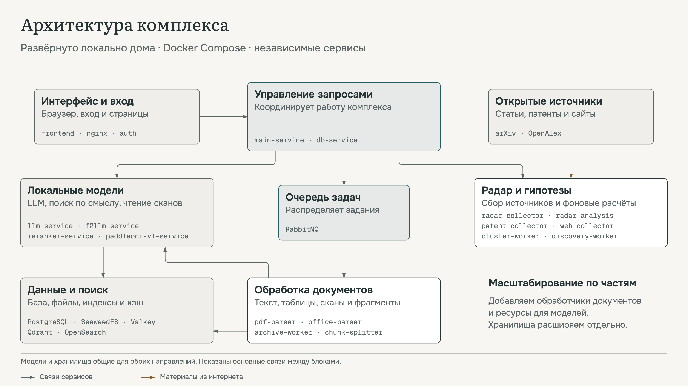

# Слабые технологические сигналы

Решение команды **«Квадрицепс»** кейса Газпромбанк.Тех.

Комплекс помогает находить ранние технологии и оценивать, какие направления стоит изучить подробнее.
Пользователь задаёт тему и получает карточки технологий с объяснениями и ссылками на источники.
Все действия выполняются в браузере.

## Команда

1. Максим Клещенок.
2. Рустам Сахабутдинов.
3. Роман Громов.

## Как открыть готовое решение

Решение уже развёрнуто на стенде. Чтобы посмотреть его вживую, зайдите по
IP-адресу с админ-доступом к платформе.

> IP-адрес и пароль администратора переданы в составе сданных материалов и в
> этом репозитории по соображениям безопасности не публикуются — возьмите
> реквизиты оттуда и войдите.

## Демо

**Полная демонстрация**

https://github.com/user-attachments/assets/1dc35aa5-ad85-4944-aace-6156bc91eb64

[Скачать полную демонстрацию (WebM)](docs/demo-full.webm?raw=1)

**Короткая демонстрация**

https://github.com/user-attachments/assets/7d50e713-bb62-438d-9085-8742f0383184

[Скачать короткую демонстрацию (WebM)](docs/demo-adhd.webm?raw=1)

## Что умеет система

- Находит научные публикации, патенты и другие открытые материалы по заданной теме.
- Собирает карточки технологий с описанием, преимуществами и примерами применения.
- Показывает оценку технологии, источники и ограничения собранных данных.
- Позволяет выгрузить результаты, искать по своим документам и готовить гипотезы.

## Архитектура

## Документация

Все материалы собраны в папке [docs](docs/) а также на [я.диск](https://disk.yandex.ru/d/cPSGvaNNZf0CeA).

- [Руководство пользователя (PDF)](docs/user_guide.pdf) — страницы, кнопки и работа с результатами.
- [Руководство по развёртыванию (PDF)](docs/deployment_guide.pdf) — запуск Docker, ключи API и подключение моделей.
- [Зависимости](docs/DEPENDENCIES.md) — необходимые компоненты и версии.
- [Архитектура](docs/ARCHITECTURE.md) — обработка данных, оценка технологий и общая схема.
- [Презентация (PDF)](docs/presentation.pdf) — краткое знакомство с комплексом.
